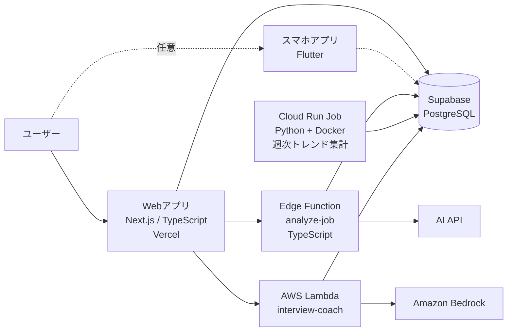

# SkillScope（スキルスコープ） 設計書（ドラフト）

> 求人票をAI（エーアイ）で分析して「市場で求められているスキル」を見える化し、
> 自分の学習ログと比べて足りないスキルを見つけ、面接の練習までできるシステム。

※ カタカナ・英語の用語には、初めて出てくるところに（読み方）を付けています。

## 1. 課題 → 手段 → 理由 → 成果

| 型 | 内容 |
|---|---|
| **課題** | 転職活動で「何を学べば採用に近づくか」が、求人を読んだときの感覚でしか分からない。学んだことを面接でうまく説明できない。 |
| **手段** | 求人票をAIで構造化してDB（ディービー／データベース）に貯め、SQL（エスキューエル）で集計する。学習ログと突き合わせて不足スキルを出し、AIが面接官役で質問する。 |
| **理由** | 求人票は文章なので、そのままでは集計できない。AIで「スキル名・必須か歓迎か」に分解すれば、数字で比べられるようになる。 |
| **成果** | （作ったあとに書く）例：求人30件を分析し、学習の優先順位を数字で決められた。面接練習を○回行った。 |

## 2. 全体構成

図に出てくる名前の読み方：

| 表記 | 読み方 | ひとことで言うと |
|---|---|---|
| Web | ウェブ | ブラウザで開くアプリ |
| Next.js | ネクストジェイエス | Webアプリの画面を作る道具 |
| TypeScript | タイプスクリプト | 型チェック付きのJavaScript（ジャバスクリプト） |
| Vercel | ヴァーセル | Webアプリを公開する場所 |
| Flutter | フラッター | スマホアプリを作る道具 |
| Supabase | スーパベース | データベース・ログイン機能などをまとめて使えるサービス |
| PostgreSQL | ポストグレスキューエル（略してポスグレ） | Supabaseの中で動いているデータベース |
| Edge Function | エッジファンクション | Supabase上で動く小さなプログラム |
| analyze-job | アナライズ・ジョブ | 「求人を分析する」という名前の機能 |
| API | エーピーアイ | プログラム同士がやり取りする窓口 |
| Cloud Run Job | クラウドラン・ジョブ | Google Cloud（グーグルクラウド）で決まった処理を実行する仕組み |
| Python | パイソン | プログラミング言語 |
| Docker | ドッカー | 実行環境を箱（コンテナ）ごと持ち運ぶ技術 |
| AWS | エーダブリューエス | Amazonのクラウドサービス |
| Lambda | ラムダ | サーバーを用意せずにプログラムを動かすAWSの仕組み |
| interview-coach | インタビュー・コーチ | 「面接コーチ」という名前の機能 |
| Amazon Bedrock | アマゾン・ベッドロック | AWS上でAIを使うサービス |

## 3. 部品ごとの役割と、学べる項目

| 部品 | 役割 | 学べる項目 |
|---|---|---|
| Supabase（DB） | 求人・スキル・学習ログを保存。集計はSQLのビュー（保存した集計クエリ）で行う | ⑥SQL ⑦用語（環境変数・権限） |
| Edge Function `analyze-job` | 求人票の文章をAIに渡し、スキル一覧（JSON（ジェイソン）形式）にしてDBに保存 | ④TypeScript |
| Webアプリ（Next.js） | 求人の登録、スキルランキング、不足スキル、面接練習の画面 | ④TypeScript ⑦デプロイ（公開作業） |
| Cloud Run Job（Python） | 週に1回、スキル出現数の推移を集計してDBに保存 | ⑤Python ⑧Docker ⑦コンテナ・ログ |
| AWS Lambda + Bedrock `interview-coach` | 学習ログから面接質問を作り、回答を「課題→手段→理由→成果」で採点 | ③AWS ①言語化 ⑦IAM（アイアム／権限管理）・リージョン（データセンターの地域）・課金 |
| Flutter アプリ（任意） | スマホで学習ログを記録・面接練習 | ⑩Flutter |
| README（リードミー）・構成図 | このドキュメントを育てて公開用READMEにする | ②ポートフォリオ ①言語化 |

⑨資格：各フェーズで出てくる用語を、AWS Cloud Practitioner（クラウドプラクティショナー）の出題範囲と対応づけてメモしていく。

## 4. データベース（最初の案）

テーブル名・列名は英語で書くのが一般的です。（ ）内は意味です。

| テーブル | 主な列 |
|---|---|
| `job_postings`（求人票） | id（番号）, user_id（ユーザー番号）, company（会社名）, title（職種名）, source_url（求人のURL（ユーアールエル））, raw_text（求人票の本文）, created_at（登録日時） |
| `skills`（スキル） | id, name（正規化した名前。例：`TypeScript`） |
| `job_skills`（求人とスキルのつながり） | job_id, skill_id, requirement（`required`＝必須 / `preferred`＝歓迎） |
| `study_logs`（学習ログ） | id, user_id, skill_id, minutes（学習時間・分）, note（メモ）, studied_on（学習した日） |
| `interview_sessions`（面接練習の記録） | id, user_id, question（質問）, answer（回答）, feedback（講評）, score（点数）, created_at |
| `skill_trends`（スキルの推移） | week（週）, skill_id, job_count（求人数）（Pythonバッチ（まとめて処理するプログラム）が書き込む） |

ビュー（SQLで集計）：
- `skill_ranking`（スキル・ランキング）：スキルごとの出現数・必須率
- `skill_gap`（スキル・ギャップ）：求人での出現数が多いのに、学習時間が少ないスキル

## 5. 進め方（フェーズ）

各フェーズの終わりに「動く状態」でGitHub（ギットハブ）に push（プッシュ／アップロード）し、READMEに一言ずつ追記する。

| # | フェーズ | 主な項目 | 目安 |
|---|---|---|---|
| 0 | リポジトリ（コードの保管場所）準備。.gitignore（ドット・ギット・イグノア）など、秘密情報を入れない仕組み | ② | 1日 |
| 1 | Supabaseにテーブルとビューを作る | ⑥⑦ | 3〜4日 |
| 2 | Edge Function `analyze-job` | ④ | 1週間 |
| 3 | Next.jsの画面（登録・ランキング・不足スキル） | ④⑦ | 1〜2週間 |
| 4 | Python の週次バッチを Docker 化して Cloud Run Job へ | ⑤⑧⑦ | 1週間 |
| 5 | AWS Lambda + Bedrock で面接コーチ | ③① | 1〜2週間 |
| 6 | Flutter アプリ（任意） | ⑩ | 余力次第 |
| 7 | README仕上げ・構成図・成果の数字を記入 | ①② | 2〜3日 |

## 6. お金と安全のルール

- APIキー（APIを使うための合言葉）は `.env`（ドット・エンブ）にだけ書き、`.env` は Git（ギット）に入れない。`.env.example`（ドット・エンブ・イグザンプル）に項目名だけ載せる。
- AWS は Phase（フェーズ） 5 の直前にアカウントを作る（無料プランの6か月を無駄にしないため）。作ったらすぐ予算アラート（AWS Budgets（バジェッツ））を設定する。
- AI の呼び出しは、1回の入力文字数に上限を設ける。

## 7. 現在の開発環境（2026-11-14 時点）

入っているもの：Node.js（ノードジェイエス） 24 / npm（エヌピーエム） / Git / Python 3.14 / Docker / GitHub CLI（シーエルアイ／コマンドで操作する道具）
必要になったら入れるもの：Supabase CLI（Phase 1）、gcloud（ジークラウド）（Phase 4）、AWS CLI（Phase 5）、Flutter（Phase 6）

## 8. スケジュール（1日6時間・日曜休み）

| 日 | 日付 | やること | ゴール |
|---|---|---|---|
| 1 | 11/16（月） | Phase 0 → Phase 1 開始 | GitHubにリポジトリ公開 |
| 2 | 11/17（火） | Phase 1 完了 → Phase 2 開始 | テーブルとビューができ、SQLで集計できる |
| 3 | 11/18（水） | Phase 2 | — |
| 4 | 11/19（木） | Phase 2 完了 → Phase 3 開始 | 求人票を送るとスキルがDBに入る |
| 5 | 11/20（金） | Phase 3 | — |
| 6 | 11/21（土） | Phase 3 | — |
| 休 | 11/22（日） | 休み | — |
| 7 | 11/23（月・祝） | Phase 3 完了・Vercelで公開 | **★Webアプリとして公開（ここで一度ポートフォリオになる）** |
| 8 | 11/24（火） | Phase 4 | — |
| 9 | 11/25（水） | Phase 4 完了・AWSアカウント作成と予算アラート設定 | 週次バッチがCloud Runで動く |
| 10 | 11/26（木） | Phase 5 | — |
| 11 | 11/27（金） | Phase 5 | — |
| 12 | 11/28（土） | Phase 5 完了 | 面接コーチが動く |
| 休 | 11/29（日） | 休み | — |
| 13 | 11/30（月） | Phase 7 README仕上げ・成果の数字を記入 | **★完成** |
| 14 | 12/1（火） | 予備日・面接コーチで自分の説明を練習 | 「課題→手段→理由→成果」で5分話せる |
| 任意 | 12/2〜12/5 | Phase 6 Flutter | スマホアプリ |

遅れたときのルール：予備日（12/1）を先に使う。それでも足りなければ、Phase 6 を後回しにする。
